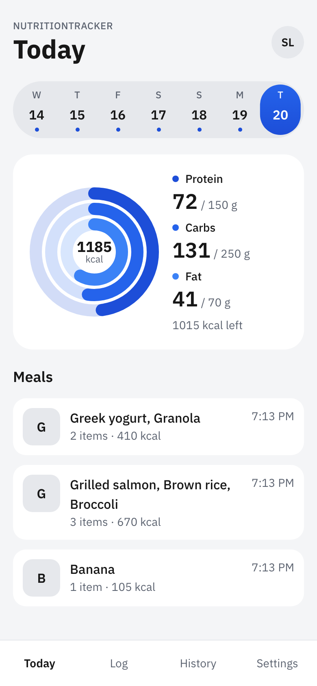
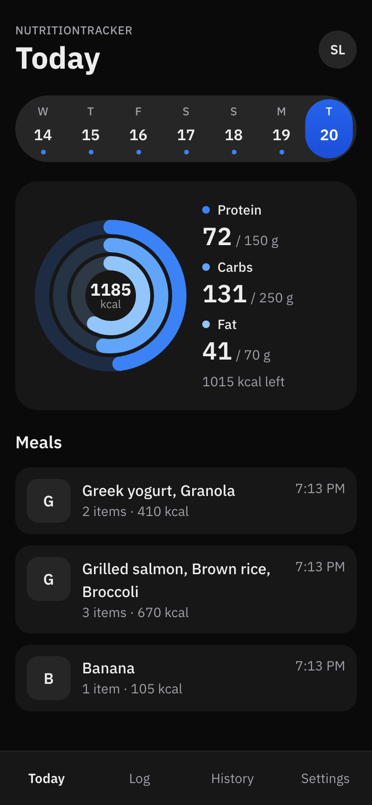
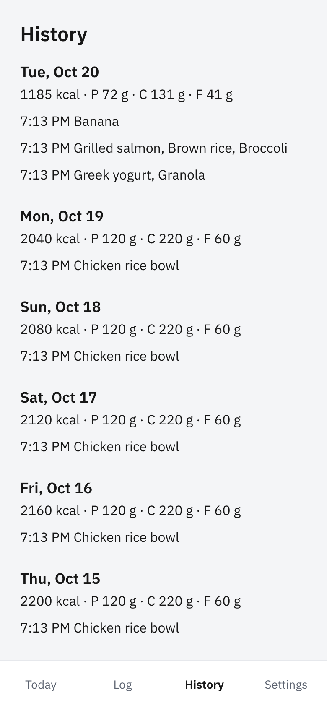
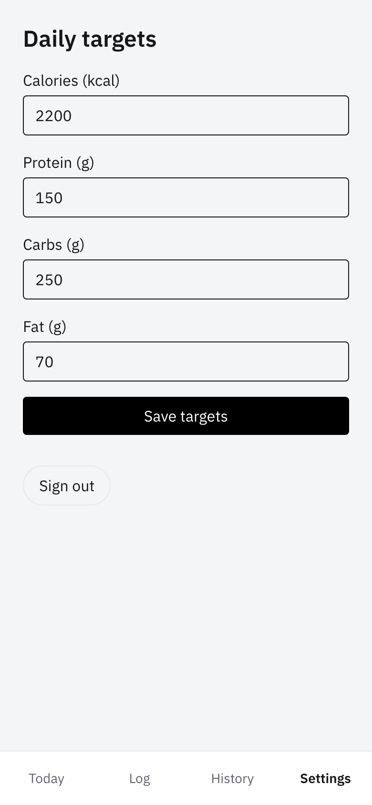

# NutritionTracker

Photo-based meal and macro tracker. Next.js 16 (App Router), Supabase (auth and Postgres), Groq for meal photo analysis.

| Today | Today (dark) | History | Settings |
|---|---|---|---|
|  |  |  |  |

## Features

- **Snap a meal.** Take or pick a photo, and a Groq vision model estimates each item's grams, calories, protein, carbs and fat. Edit any estimate before saving. If analysis fails or you hit Cancel, use **Enter manually**. Photos are never stored.
- **Today at a glance.** Three concentric rings track Protein, Carbs and Fat against your targets, with total kcal in the centre and "kcal left" or "kcal over" beneath.
- **Last 7 days.** A week strip switches between days instantly. A dot marks days that landed within 90–110% of your calorie target.
- **Meals list.** Each meal shows its items, item count, kcal and logged time.
- **History.** Past days with daily totals and every meal.
- **Daily targets.** Set calories, protein, carbs and fat in Settings.
- **Passwordless sign-in.** A Supabase magic link. Row-level security keeps each user's data private.
- **Time-zone aware.** "Today" follows your device's time zone, not the server's.
- **Mobile-first and accessible.** A 100dvh column (max 430px) with a bottom tab bar, light and dark themes, keyboard navigation in the week strip (arrows, Home and End), screen-reader labels, and `prefers-reduced-motion` support.

## Tech stack

Next.js 16 (App Router, Server Components and Server Actions), React 19, TypeScript, Tailwind CSS v4, Supabase (`@supabase/ssr`, Postgres with RLS), Groq, zod, Vitest, Playwright and pgTAP.

## Local development

Prerequisites: Node 22.12+ and Docker (for the local Supabase stack).

One-time, install the Playwright browser:

```bash
npm install
npx playwright install chromium
```

Full local gate, in order:

```bash
npm run db:start && npx supabase db reset && npm run db:test
npm run env:local
npm run lint && npm run typecheck && npm test && npm run build
npm run e2e
```

`npm run env:local` writes `.env.local` from the running local Supabase stack. `GROQ_API_KEY` is server-only and is not needed for any test. Never add a Supabase service-role or secret key.

## Deploy (human steps)

These steps are not done by the Engineer or QA. Do them before merge and deploy. The model ID is the `ANALYZE_MODEL` constant in `lib/analyze.ts`. The migration is `supabase/migrations/20261020000000_nutrition_mvp.sql`.

- **H1** Create the Supabase project. Copy the Project URL and the **publishable** key (Settings → API Keys).
- **H2 (migration — before merge/deploy, FC-01):** `npx supabase login && npx supabase link --project-ref <ref> && npx supabase db push`. This applies `20261020000000_nutrition_mvp.sql` to production.
- **H3** Supabase dashboard → Authentication:
  - Site URL = the Vercel production URL;
  - edit **both** the "Magic Link" and "Confirm signup" templates so the link is `{{ .SiteURL }}/auth/confirm?token_hash={{ .TokenHash }}&type=email`;
  - configure custom SMTP (the built-in mailer is rate-limited);
  - after creating your own account, consider turning off "Allow new users to sign up" until scan limits exist (cost control).
- **H4** In the Groq console (free tier):
  - create `GROQ_API_KEY`;
  - in Settings → Data Controls, turn on **Zero Data Retention**, since meal photos would otherwise be loggable for up to 30 days;
  - in Settings → Limits, read the real free-tier RPM/RPD/TPM/TPD for `qwen/qwen3.8-27b` and record them in `README.md`. The plan's 30/1K/8K/200K figures come from the docs' Developer-plan base table;
  - watch Groq's deprecations page, because the model is in preview.
- **H5** Import the GitHub repo (`dnmrk/nutrition-tracker`) in Vercel. Set the env vars `NEXT_PUBLIC_SUPABASE_URL`, `NEXT_PUBLIC_SUPABASE_PUBLISHABLE_KEY` and `GROQ_API_KEY` (server-only). **Do not add a service-role or secret key.** Check that the preview build succeeds (FC-02). Magic links always point to the Site URL, so sign-in on preview deployments isn't supported in the MVP.
- **H6** Allow these if your permission settings prompt for them:
  - `npx supabase start`/`db reset`/`test db` (Docker);
  - `npx playwright install chromium` (downloads to `~/Library/Caches/ms-playwright`).
- **H7** Real-photo smoke test, after Task 7. Add `GROQ_API_KEY` to `.env.local`, run `npm run dev`, sign in at `http://127.0.0.1:3000`, and snap one real meal. This confirms JSON mode works with a real image, and that no reasoning text (`<think>`) leaks into `content`. If it fails, or reasoning shows up, send the response to the Engineer. The fix is a request-parameter change in `lib/analyze.ts`, using Groq's reasoning parameters for this model.
- **H8 (gate):** do not turn Supabase sign-ups back on (H3) until the per-user daily analysis cap (see Deferred) has shipped.

## Deferred

- Saved-foods pantry.
- Barcode or nutrition-label scanning.
- Trend charts.
- Body weight logging.
- Reminders or daily summaries.
- Stripe and paid scan limits.
- **Per-user daily analysis cap (decided: deferred). Gate: it must ship before Supabase sign-ups are opened (H8).** Planned shape: an `analysis_usage (user_id, day, count)` table with RLS, plus a migration and a prod apply; a check-and-increment in `/api/analyze` before calling Groq, returning 429 `You've reached today's photo limit. Enter the meal manually.`; a pgTAP test and a route test.
- Storing meal photos (decided: not stored).
- Editing or deleting a saved meal (decided: deferred).
- `meal_type` (breakfast/lunch/…) and stored `confidence`.
- Google OAuth.
- Sign-in on preview deployments.
- A CI workflow.
- Aligning the `/log` and `/settings` buttons with the theme tokens in `app/globals.css`.
